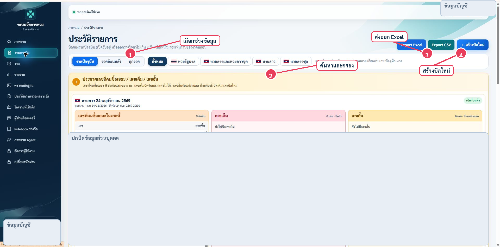
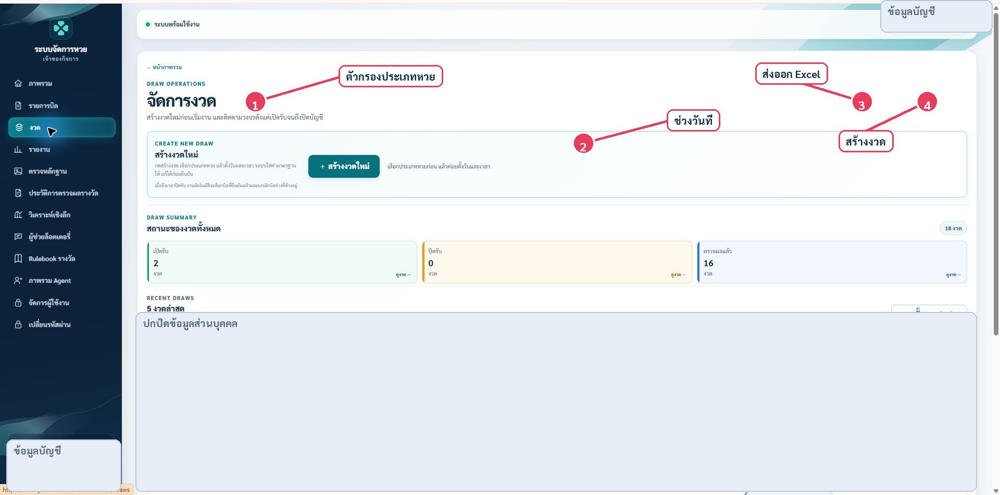
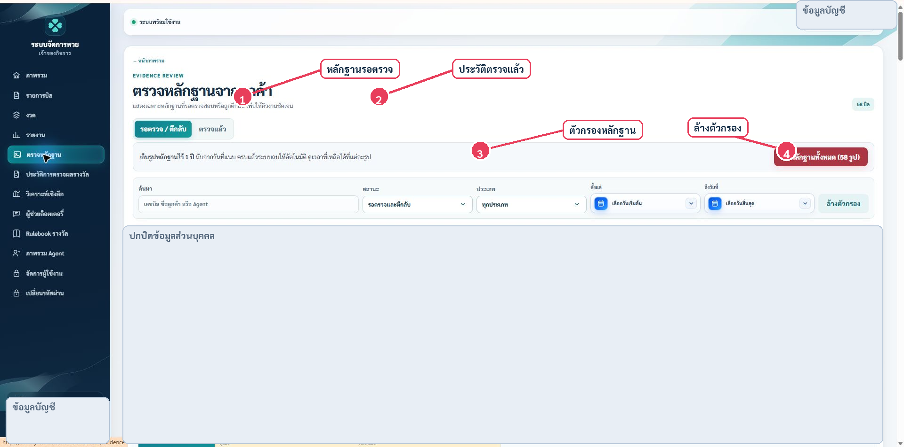
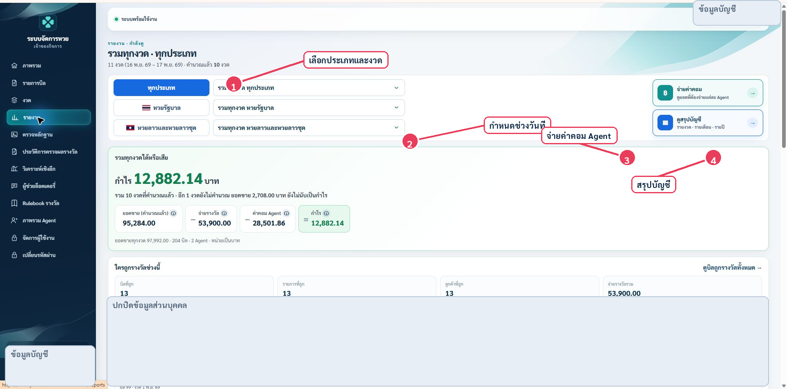
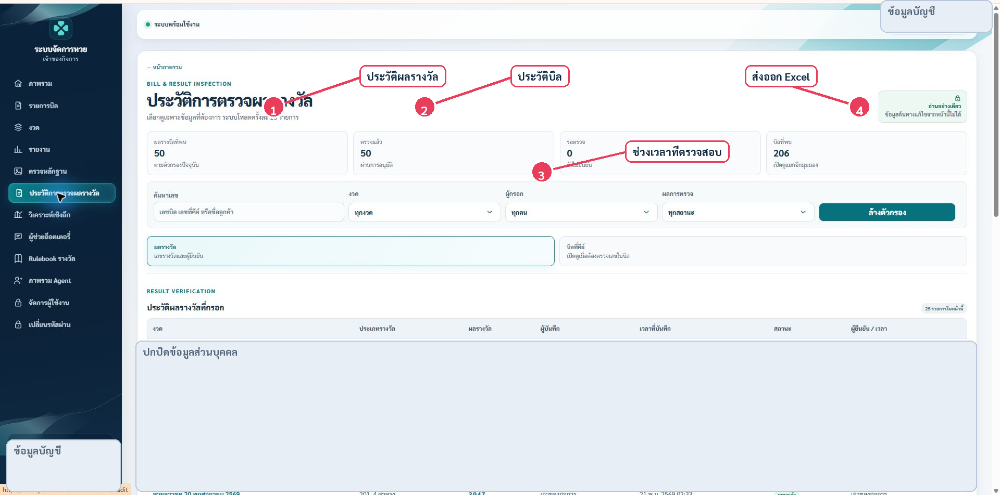

# คู่มือเฉพาะบทบาท Admin

**บทบาท:** ผู้ปฏิบัติงานและผู้ตรวจสอบ  
**สถานะการตรวจ:** ตรวจสอบ Permission/Navigation/Server Actions จาก Source Code; ไม่ได้ Login ด้วยบัญชี Admin เพราะไม่มีรหัสผ่านทดสอบ

## หน้าที่และสิทธิ์

Admin ดูรายงานทุก Agent จัดการงวดและบิล ลงผล ยืนยันผล กระทบยอด ทำเครื่องหมายจ่ายคอม ตรวจหลักฐาน และดู Audit ได้ แต่จัดการผู้ใช้/Agent ลบงวด ลบหลักฐาน อนุมัติปิดบัญชี และอนุมัติการแก้ผลไม่ได้

## เมนูที่ใช้ได้

ภาพรวม, รายการบิล, งวด, รายงาน, ตรวจหลักฐาน, ประวัติการตรวจผลรางวัล, Rulebook รางวัล, ภาพรวม Agent และเปลี่ยนรหัสผ่าน

## งานเริ่มต้น

1. Login และเปลี่ยนรหัสผ่านหากระบบบังคับ
2. ตรวจ Dashboard และขอบเขตงวด
3. ตรวจบิล/หลักฐานค้าง
4. ปิดรับงวดตามเวลาและลงผลให้ครบ
5. กระทบยอดก่อนส่ง Owner อนุมัติ

## รายการบิล

① ช่วงข้อมูล ② ตัวกรอง ③ Export Excel ④ สร้างบิล  
Admin จัดการบิลทั้งองค์กรได้ตามเงื่อนไข Cutoff/ผลรางวัล แต่ต้องหลีกเลี่ยงการแก้แทน Agent โดยไม่มีเหตุผล

## งวดและผลรางวัล

Admin สร้าง ปิด และเปิดรับงวดที่ล็อกแล้วได้หากยังไม่มีผล/Settlement แต่ไม่มีสิทธิ์ลบงวด เมื่อผลครบ ระบบคำนวณการเงิน; หากแก้ผลหลังประกาศให้ส่งคำขอพร้อมเหตุผลเพื่อรอ Owner

## ตรวจหลักฐาน

เปิดไฟล์ ตรวจบิลและความซ้ำ เลือก VERIFIED หรือ REJECTED พร้อมเหตุผล Admin ไม่มีสิทธิ์ลบหลักฐาน

## กระทบยอดและค่าคอม

เลือกงวด/ช่วงวันที่ ตรวจยอดขาย จ่ายรางวัล ค่าคอม และยอดหลังหักคอม จากนั้นกระทบยอด Settlement หรือทำเครื่องหมายจ่ายคอม ระบบไม่โอนเงินจริง

## Audit

Admin เห็น Audit ทั้งองค์กรและ Export Excel ได้ ใช้ยืนยันว่าใครแก้สถานะหรือผลเมื่อใด

## ข้อจำกัดและการส่งต่อ Owner

- ลบงวด/หลักฐาน → ส่ง Owner
- สร้าง/ระงับ/ลบผู้ใช้หรือแก้ Agent → ส่ง Owner
- อนุมัติ Settlement → ส่ง Owner หลัง Reconcile
- อนุมัติคำขอแก้ผล → ส่ง Owner
- ตั้งเพดานเฉพาะเลขหรือปลดเลขเต็มแบบ Override → ส่ง Owner

## Troubleshooting

หากปุ่มไม่ปรากฏ ให้ตรวจว่าการกระทำนั้นเป็นสิทธิ์ Owner หรือไม่ หากลงผลแล้วไม่คำนวณ ให้ตรวจผลครบทุกประเภท หากเปิดงวดไม่ได้ ให้ตรวจว่ามีผลหรือ Settlement แล้วหรือยัง
