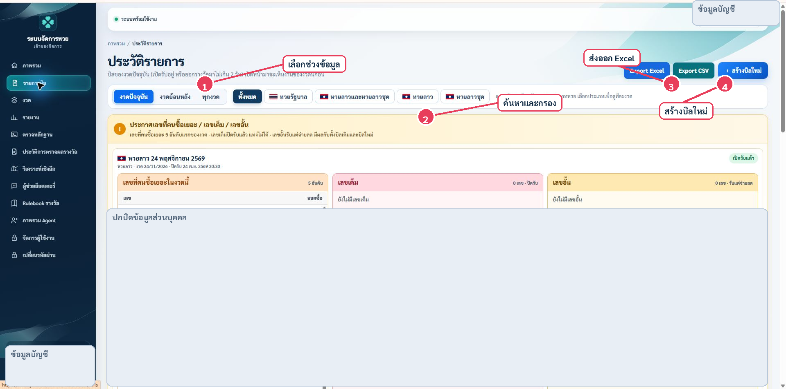
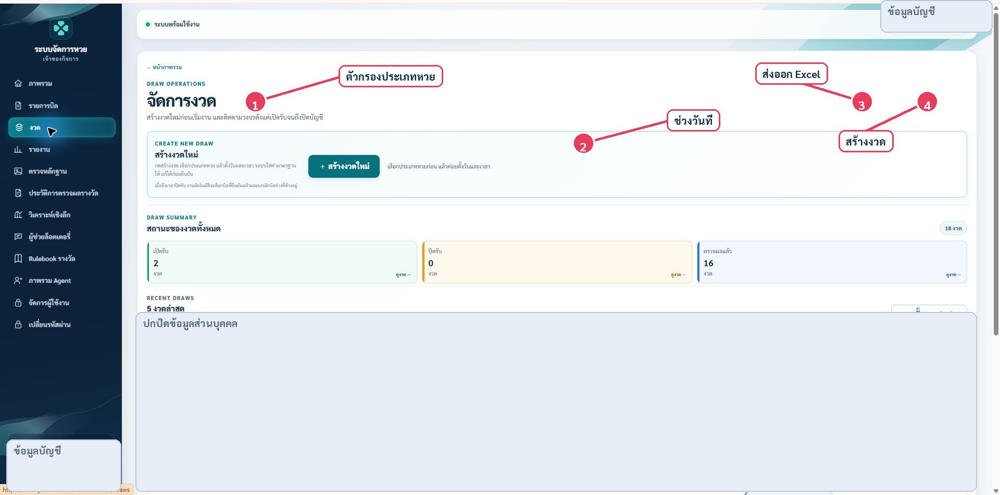
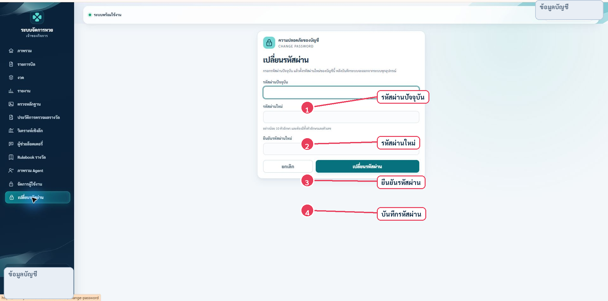

# คู่มือเฉพาะบทบาท Agent

**บทบาท:** รับบิลและดูผลงานของตน  
**สถานะการตรวจ:** ตรวจสอบ Permission/Navigation/Server Actions จาก Source Code; ไม่ได้ Login ด้วยบัญชี Agent เพราะไม่มีรหัสผ่านทดสอบ

## หน้าที่และสิทธิ์

Agent สร้าง ยืนยัน แก้ และลบบิลของตนก่อน Cutoff ดูงวด ดูรายงาน/ประวัติของตน ดูและอัปโหลดหลักฐาน และเปลี่ยนรหัสผ่าน ไม่เห็นข้อมูลของ Agent อื่นและไม่มีสิทธิ์จัดการงวด ผล ผู้ใช้ Agent หรือหลักฐานของผู้อื่น

## เมนูที่ใช้ได้

รายการบิล, งวด, รายงาน และเปลี่ยนรหัสผ่าน เมื่อ Login สำเร็จระบบพาไป `/bills`

## รับบิลทีละขั้นตอน

1. เปิด “รายการบิล” และกด “สร้างบิลใหม่”
2. เลือกงวดที่ OPEN และยังไม่ถึง Cutoff
3. กรอกชื่อลูกค้าให้สม่ำเสมอ เพื่อให้รายงานลูกค้าไม่แยกชื่อซ้ำ
4. เพิ่มประเภทรางวัล เลข และยอด/จำนวนชุด
5. แก้ข้อความเตือนเลขผิดหลัก ยอดต่ำ/สูงเกิน เลขเต็ม เลขอั้น หรือวงเงิน
6. บันทึกร่างหากยังไม่พร้อม หรือยืนยันเพื่อออกเลขบิล
7. แนบหลักฐานให้บิลเมื่อจำเป็น

① เลือกช่วงข้อมูล ② ค้นหา/กรอง ③ Export ตามสิทธิ์ ④ สร้างบิล  
Agent เห็นเฉพาะบิลและขอบเขตของตน แม้ภาพประกอบเก็บจาก Owner Session

## แก้ไขหรือลบบิล

เปิดรายละเอียดบิลของตน หากยังไม่ Cutoff และสถานะอนุญาต ให้แก้รายการหรือยกเลิกตามปุ่มที่ระบบแสดง หลังล็อกงวดหรือลงผลแล้วต้องติดต่อ Admin/Owner และอ้างอิงเลขบิล

## ดูงวด

ตรวจประเภทหวย วันออกผล Cutoff และสถานะก่อนรับบิล Agent ไม่มีสิทธิ์สร้าง ปิด เปิดรับ หรือลบงวด

## หลักฐาน

Agent ดูและอัปโหลดหลักฐานให้บิลของตนได้ หากหลักฐานถูกปฏิเสธ ให้อ่านเหตุผลและส่งใหม่ผ่านขั้นตอน Resubmit ห้ามอัปโหลดไฟล์ที่มีข้อมูลเกินความจำเป็น

## รายงานของตน

ตรวจยอดบิล ยอดขาย ผลถูกรางวัล และข้อมูลที่ระบบเปิดให้ Agent ตามงวด/ช่วงวันที่ Agent ไม่มี `report.viewAllAgents` จึงไม่ควรเห็นข้อมูล Agent อื่น

## เปลี่ยนรหัสผ่าน

กรอกรหัสเดิม รหัสใหม่ และยืนยัน จากนั้น Login ใหม่ ระบบตัด Session ทั้งหมดหลังเปลี่ยนสำเร็จ

## ข้อควรระวัง

- ตรวจงวดและ Cutoff ก่อนรับบิลทุกครั้ง
- ตรวจเลขและยอดก่อนยืนยัน เพราะอัตราจ่ายถูก snapshot ตอนยืนยัน
- อย่าใช้ชื่อลูกค้าหลายรูปแบบกับคนเดียวกัน
- ห้ามส่งรหัสผ่านหรือข้อมูลลูกค้าในช่องทางสาธารณะ
- เมื่อบิลแก้ไม่ได้ ให้จดเลขบิลและติดต่อ Admin/Owner

## ปัญหาที่พบบ่อย

หากเข้าระบบไม่ได้ อาจถูก SUSPENDED ให้ติดต่อ Owner หากยืนยันบิลไม่ได้ให้อ่าน Validation และตรวจวงเงิน หากเลขถูกปิดรับให้เลือกเลขอื่นหรือติดต่อผู้ดูแล ห้ามพยายามหลีกเลี่ยงเพดานด้วยการสร้างรายการซ้ำ
