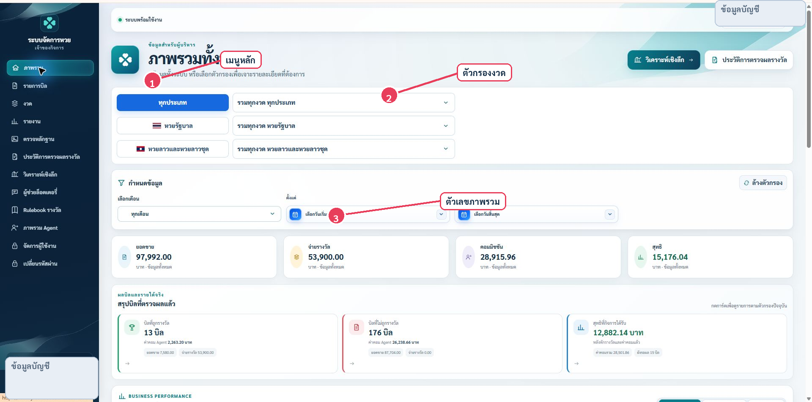
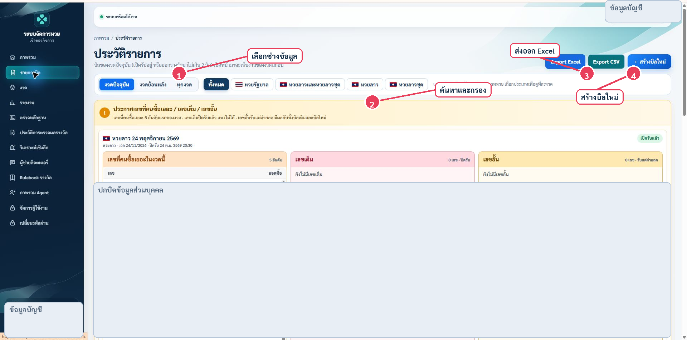
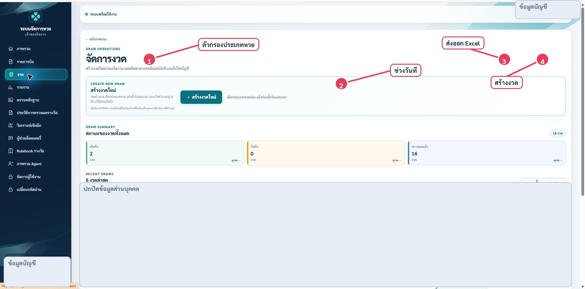
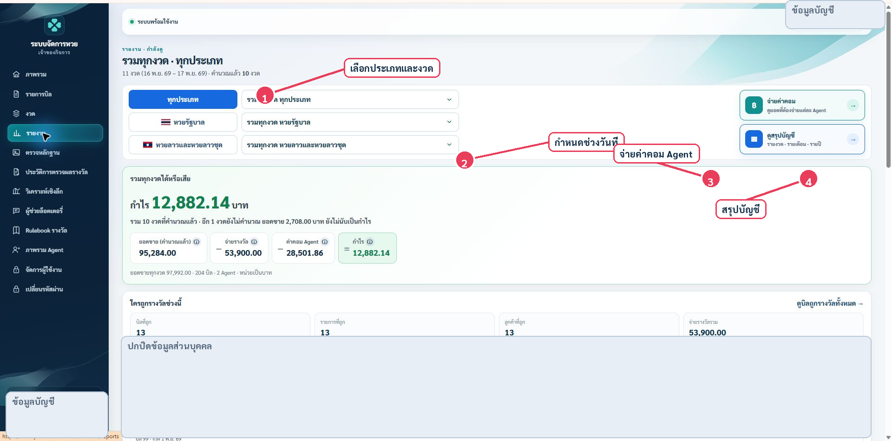
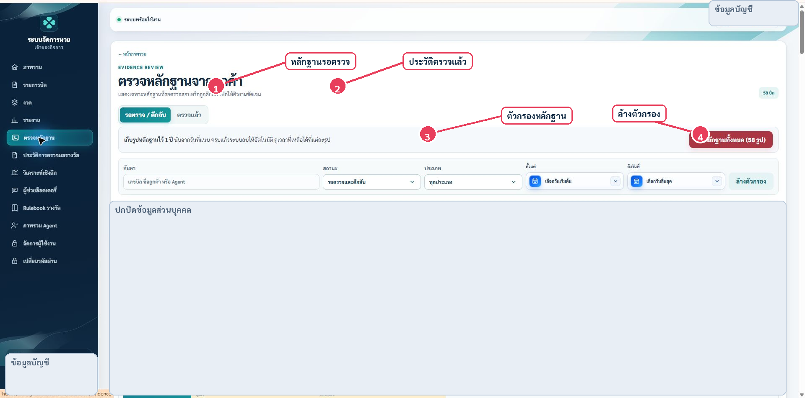
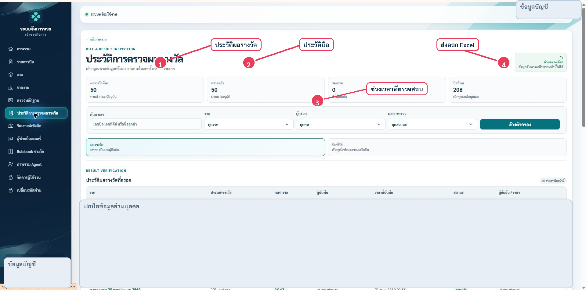
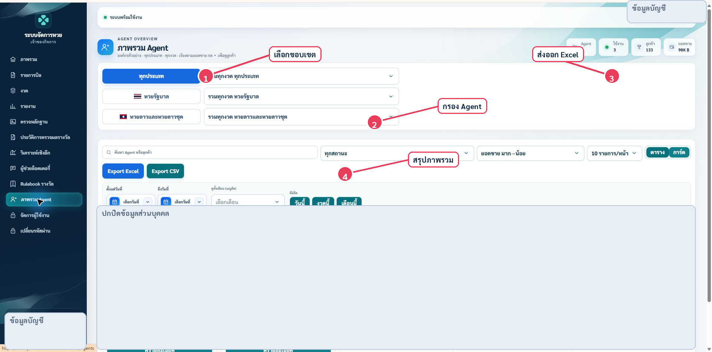
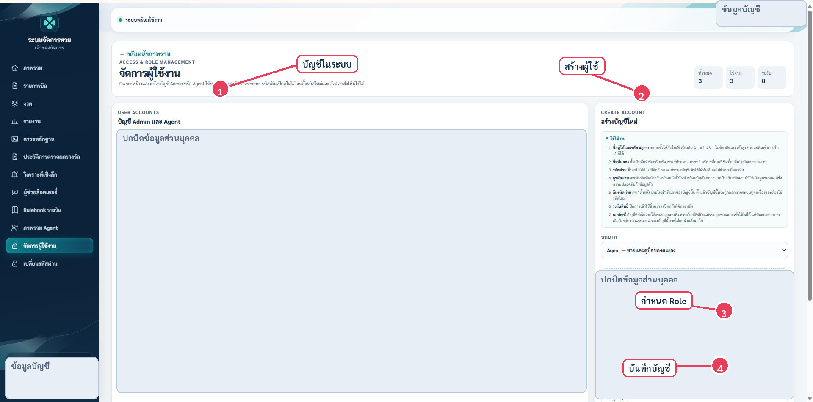
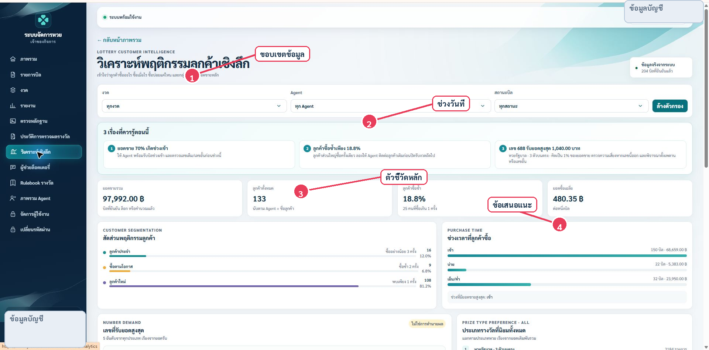
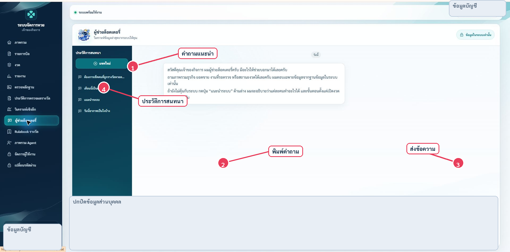

# คู่มือเฉพาะบทบาท Owner

**บทบาท:** เจ้าของกิจการและผู้อนุมัติขั้นสุดท้าย  
**สถานะการตรวจ:** ทดสอบหน้าจอจริงด้วย Session Owner

## หน้าที่และสิทธิ์

Owner เข้าถึงข้อมูลทุก Agent จัดการงวด ผู้ใช้ Agent ผลรางวัล Settlement ค่าคอม หลักฐาน รายงาน Audit Analytics และผู้ช่วย AI ได้ รวมถึงสิทธิ์พิเศษในการลบงวด ลบหลักฐาน ตั้งเพดานเฉพาะเลข อนุมัติการแก้ผล และปิดบัญชี

## Dashboard และเมนู

① เมนูหลัก ② ตัวกรอง ③ KPI ④ รายการติดตาม  
ตรวจขอบเขตตัวกรองก่อนอ่านยอดเสมอ และแยก “รอผล” ออกจากกำไร/ขาดทุน

## งานประจำวัน

1. เปิด Dashboard ตรวจงวดรอปิด หลักฐานรอตรวจ และยอดผิดปกติ
2. ตรวจงวดและเลขเต็ม/เลขอั้น
3. ตรวจผลรางวัลและคำขอแก้ผล
4. ตรวจสรุปบัญชี/ค่าคอมและอนุมัติรายการที่ครบเงื่อนไข
5. ตรวจ Audit เมื่อพบยอดหรือสถานะผิดปกติ

## รายการบิลและงวด

① ช่วงข้อมูล ② ตัวกรอง ③ Export Excel ④ สร้างบิล  
Owner จัดการบิลได้ทั้งองค์กรจนถึงเงื่อนไขที่ระบบอนุญาต แต่ควรให้ Agent เจ้าของงานแก้ก่อน และใช้ Audit ตรวจทุกการลบ

① ประเภทหวย ② ช่วงวันที่ ③ Export Excel ④ สร้างงวด  
การลบงวดอาจลบบิลในงวดนั้น ต้องตรวจชื่อและจำนวนบิลในข้อความยืนยัน

## รายงานและการเงิน

① ขอบเขตหวย/งวด ② ช่วงวันที่ ③ จ่ายค่าคอม ④ สรุปบัญชี  
กำไร = ยอดขายงวดที่คำนวณแล้ว − จ่ายรางวัล − ค่าคอม งวดรอผลไม่นับกำไร Export Excel สรุปบัญชีแยกรายงวดและราย Agent

## หลักฐานและ Audit

Owner ยืนยัน ปฏิเสธ และลบหลักฐานได้ การปฏิเสธต้องมีเหตุผล ห้ามลบก่อนแน่ใจว่าไม่มีภาระตรวจสอบหรือข้อพิพาท

ใช้ค้นหาผู้กระทำ เวลา ก่อน/หลัง และเหตุผล Export Excel เฉพาะขอบเขตที่จำเป็น

## Agent และผู้ใช้

ใช้ตรวจยอดขาย จ่ายรางวัล ค่าคอม ลูกค้า และสถานะราย Agent การเปลี่ยนสถานะเป็น SUSPENDED หยุดการเข้าสู่ระบบของ Agent

Owner เป็น Role เดียวที่สร้าง แก้ ระงับ Reset และลบบัญชี ตรวจ Role ก่อนบันทึกและส่งรหัสชั่วคราวผ่านช่องทางปลอดภัย

## Analytics และ AI

ใช้ดูแนวโน้มตามตัวกรอง ไม่ควรตีความความสัมพันธ์เป็นเหตุผลเชิงสาเหตุ

ห้ามส่ง Password, Token หรือข้อมูลส่วนบุคคลที่ไม่จำเป็น และต้องตรวจคำตอบกับรายงานก่อนตัดสินใจ

## Workflow อนุมัติปิดบัญชี

ตรวจผลครบ → ตรวจ Settlement → ตรวจการกระทบยอดของ Admin → ตรวจยอดขาย/จ่ายรางวัล/ค่าคอม → อนุมัติ → ตรวจ Audit และสถานะ CLOSED  
หากยอดไม่ตรง ห้ามอนุมัติ ให้ย้อนตรวจบิล ผลรางวัล snapshot อัตราจ่าย และค่าคอม

## ข้อควรระวัง

- การลบงวด/ผู้ใช้/หลักฐานมีผลกว้าง ต้องอ่านข้อความยืนยันทุกครั้ง
- การแก้ผลหลังประกาศทำให้ระบบคำนวณใหม่ ต้องมีเหตุผลและตรวจยอดหลังแก้
- การทำเครื่องหมายจ่ายคอมเป็นบันทึก ไม่ใช่การโอนเงินจริง
- AI และ Analytics เป็นเครื่องมือสนับสนุน ไม่แทนการตรวจบัญชี

## ปัญหาที่พบบ่อย

หากกำไรไม่แสดง ให้ตรวจว่างวดคำนวณแล้วหรือไม่ หากคำขอแก้ผลค้าง ให้เปิดรายละเอียดงวดและตรวจสิทธิ์อนุมัติ หากลบผู้ใช้ไม่ได้ ให้ตรวจว่าระบบต้องเก็บประวัติบิลและใช้โหมดลบแบบเก็บประวัติ
