# คู่มือการใช้งานระบบบริหารจัดการลอตเตอรี่

**เวอร์ชันระบบ:** 0.1.0 (อ้างอิง Repository ณ วันที่ 24 พฤศจิกายน 2569)  
**วันที่จัดทำ:** 24 พฤศจิกายน 2569  
**กลุ่มผู้อ่าน:** เจ้าของกิจการ ผู้ดูแลระบบ Agent และพนักงานใหม่

เอกสารนี้อธิบายระบบจาก Source Code, Database Schema, Permission Matrix และหน้าจอจริงที่เปิดใช้งานได้ โดยข้อมูลชื่อบุคคลและรายการเฉพาะลูกค้าในภาพถูกปิดบังแล้ว ภาพหน้าจอแบบโต้ตอบตรวจสอบด้วยบัญชีบทบาท Owner ส่วน Admin และ Agent ตรวจสอบสิทธิ์จากโค้ดและโครงสร้างเมนู เนื่องจากไม่มีรหัสผ่านทดสอบของสองบทบาทดังกล่าว

## สารบัญและวิธีใช้คู่มือ

เริ่มจาก “ภาพรวมระบบ” เพื่อเข้าใจคำศัพท์และสถานะ จากนั้นอ่านหัวข้อตาม Role ของตน หากต้องทำงานตั้งแต่ต้นจนจบให้เปิด “Workflow งานสำคัญ” และเมื่อพบปัญหาให้ค้นจาก “Troubleshooting” หรือ “FAQ”

> หมายเหตุ: เลข ① ② ③ ④ ในภาพตรงกับคำอธิบายใต้ภาพทุกครั้ง ข้อความ “ปกปิดข้อมูลส่วนบุคคล” หมายถึงข้อมูลจริงที่ถูกซ่อนเพื่อความปลอดภัย

## PART 1 — ภาพรวมระบบ

### 1.1 ระบบนี้ใช้ทำอะไร

ระบบบริหารจัดการลอตเตอรี่ใช้จัดการวงจรงานตั้งแต่เปิดงวด รับและยืนยันบิล เก็บหลักฐาน กำหนดเลขเต็ม/เลขอั้น ลงผลรางวัล คำนวณยอดจ่ายและค่าคอม กระทบยอด ปิดบัญชี ไปจนถึงดูรายงานและตรวจสอบย้อนหลัง ระบบรองรับหวยรัฐบาล หวยลาว และหวยลาวชุด โดยแยกสิทธิ์เป็น Owner, Admin และ Agent

### 1.2 ภาพรวมการทำงาน

1. Owner หรือ Admin สร้างงวดและกำหนดวัน–เวลาปิดรับ
2. Agent หรือผู้มีสิทธิ์สร้างบิล ใส่ลูกค้าและรายการแทง แล้วตรวจสอบก่อนยืนยัน
3. ระบบออกเลขบิลและบันทึกอัตราจ่าย ณ เวลายืนยัน เพื่อให้คำนวณย้อนหลังได้
4. เมื่อถึง Cutoff ระบบล็อกงวดและบิลที่ยืนยันแล้ว พร้อมยกเลิกร่างค้างตามกระบวนการปิดงวด
5. Owner/Admin ลงผลรางวัล ระบบจับคู่ EXACT, PERMUTATION หรือ CONTAINS_DIGIT ตาม Rulebook
6. ระบบคำนวณยอดขาย จ่ายรางวัล ค่าคอม และกำไร/ขาดทุน
7. Admin กระทบยอด และ Owner อนุมัติปิดบัญชีงวด
8. ทุกการเปลี่ยนแปลงสำคัญมี Audit Event สำหรับตรวจสอบย้อนหลัง

### 1.3 แผนผังสถานะหลัก

**งวด:** OPEN → LOCKED → RESULT_PENDING → SETTLED → CLOSED  
**บิล:** DRAFT → CONFIRMED → LOCKED → SETTLED หรือ CANCELLED  
**ผลรางวัล:** DRAFT → APPROVED หรือ REJECTED  
**Settlement:** DRAFT → RECONCILED → APPROVED  
**หลักฐาน:** PENDING → VERIFIED หรือ REJECTED

ข้อควรระวัง: เมื่อปิดบัญชีงวดแล้วข้อมูลทางการเงินไม่ควรถูกแก้ไข หากต้องแก้ผลที่ประกาศแล้ว Admin ส่งคำขอแก้และ Owner อนุมัติ ส่วน Owner แก้ได้โดยตรงพร้อม Audit และคำนวณใหม่

### 1.4 คำศัพท์สำคัญ

| คำศัพท์ | ความหมายในระบบ |
|---|---|
| งวด | รอบรับบิลที่มีประเภทหวย วันที่ออกผล และเวลาปิดรับ |
| Cutoff | เวลาสิ้นสุดการรับหรือแก้ไขบิลของงวด |
| บิลร่าง | บิลที่ยังแก้ไขได้และยังไม่ถูกนำไปคิดยอด |
| บิลยืนยัน | บิลที่ระบบออกเลขบิลและล็อกอัตราจ่าย snapshot แล้ว |
| เลขเต็ม | เลขที่ปิดรับเพิ่ม |
| เลขอั้น | เลขที่ยังรับได้ แต่อัตราจ่ายลดลงตามที่กำหนด |
| ยอดขาย | เงินแทงรวมจากบิลยืนยันแล้ว ไม่รวมร่างและบิลที่ลบ |
| จ่ายรางวัล | เงินที่ต้องจ่ายให้รายการที่ถูกรางวัลของงวดที่คำนวณแล้ว |
| ค่าคอม Agent | เปอร์เซ็นต์จากยอดขายตามเรตของ Agent และประเภทหวย |
| หลังหักคอม | ยอดขาย − ค่าคอม |
| กำไร/ขาดทุน | ยอดขายของงวดที่คำนวณแล้ว − จ่ายรางวัล − ค่าคอม |
| รอผล | ยอดของงวดที่ยังไม่คำนวณ จึงยังไม่นับเป็นกำไร/ขาดทุน |

## PART 2 — การเข้าสู่ระบบ

### 2.1 เข้าสู่ระบบ

**ฟังก์ชันคืออะไร:** จุดยืนยันตัวตนก่อนเข้าถึงข้อมูล  
**ใช้ทำอะไร:** ตรวจชื่อผู้ใช้ รหัสผ่าน สถานะบัญชี และ Role  
**เข้าจาก:** URL ของระบบ `/login`

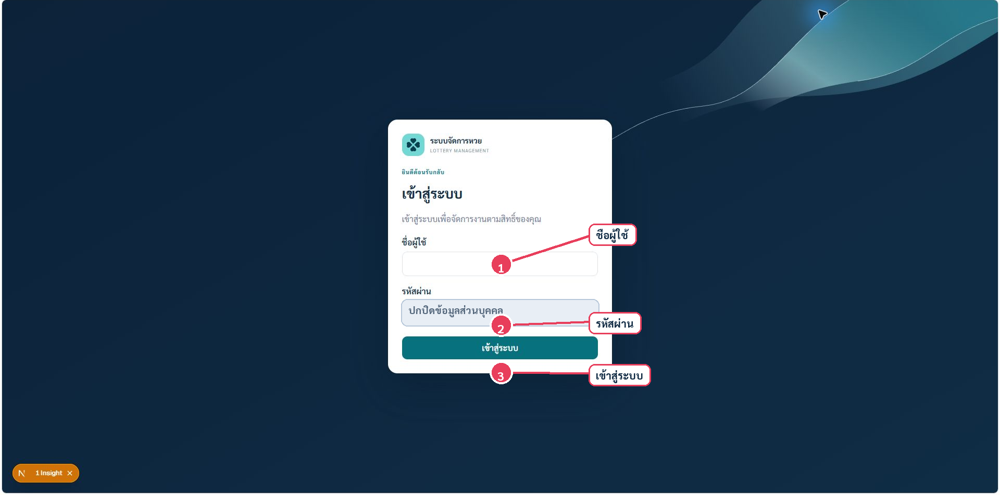

① กรอกชื่อผู้ใช้ ระบบแปลงเป็นตัวพิมพ์เล็กก่อนตรวจสอบ  
② กรอกรหัสผ่าน โดยไม่ควรเปิดเผยหรือบันทึกลงเอกสาร  
③ กด “เข้าสู่ระบบ” หากบัญชีถูกต้อง ระบบพา Agent ไปหน้ารายการบิล และพา Owner/Admin ไปหน้าภาพรวม

ขั้นตอนใช้งาน:

1. เปิด URL ที่ผู้ดูแลระบบแจ้ง
2. กรอกชื่อผู้ใช้และรหัสผ่าน
3. กด “เข้าสู่ระบบ” เพียงครั้งเดียวและรอระบบตอบสนอง
4. หากระบบบังคับเปลี่ยนรหัสผ่าน ให้ตั้งรหัสใหม่ก่อนใช้งานเมนูอื่น

ผลลัพธ์สำเร็จ: ระบบสร้าง Session แบบ Cookie และแสดงเมนูตาม Role  
ข้อผิดพลาดที่พบได้: ไม่กรอกชื่อผู้ใช้/รหัสผ่าน, ข้อมูลไม่ถูกต้อง, ไม่มีองค์กรที่ Active, บัญชี Agent ถูกระงับ

### 2.2 เปลี่ยนรหัสผ่าน

**ฟังก์ชันคืออะไร:** เปลี่ยนรหัสผ่านของบัญชีปัจจุบัน  
**เข้าจาก:** เมนู “เปลี่ยนรหัสผ่าน”

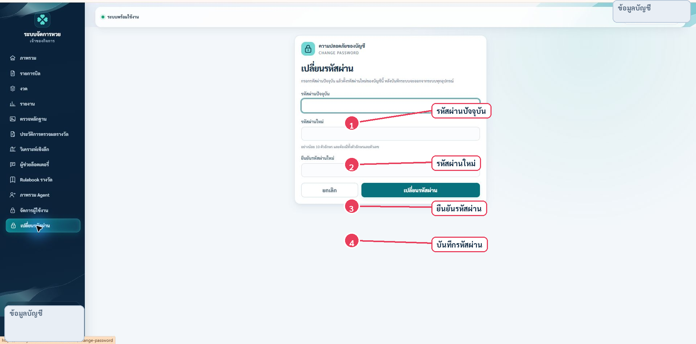

① รหัสผ่านปัจจุบัน ② รหัสผ่านใหม่ ③ ยืนยันรหัสผ่านใหม่ ④ บันทึก  
หลังเปลี่ยนสำเร็จ ระบบยกเลิก Session ทั้งหมดและพากลับหน้า Login ต้องเข้าสู่ระบบใหม่ด้วยรหัสผ่านใหม่ หากยืนยันไม่ตรงกัน ระบบแสดง “รหัสผ่านใหม่และการยืนยันไม่ตรงกัน”

### 2.3 Logout และลืมรหัสผ่าน

Logout ทำได้จากเมนูบัญชี ระบบลบ Session แล้วกลับหน้า Login ส่วนระบบไม่มีหน้าลืมรหัสผ่านแบบส่งอีเมล ผู้ใช้ต้องติดต่อ Owner ให้ Reset Password ในหน้าจัดการผู้ใช้งาน และควรเปลี่ยนรหัสผ่านทันทีหลังได้รับรหัสชั่วคราว

## PART 3 — บทบาทและสิทธิ์

### 3.1 ตาราง Role

| Role | หน้าที่ | สิทธิ์หลัก | ข้อจำกัด |
|---|---|---|---|
| Owner | เจ้าของกิจการและผู้อนุมัติขั้นสุดท้าย | ทุกหน้ารายงาน จัดการ Agent/ผู้ใช้/งวด อนุมัติปิดบัญชี แก้ผล อนุมัติการแก้ผล ลบหลักฐาน ตั้งเพดานเลข ใช้ Analytics และ AI | ต้องระวังการลบและการอนุมัติ เพราะมีผลทั้งองค์กร |
| Admin | ปฏิบัติงานและตรวจสอบ | จัดการงวด/บิล ลงผล กระทบยอด จ่ายคอม ตรวจหลักฐาน ดู Audit และรายงานทุก Agent | จัดการผู้ใช้/Agent ไม่ได้ ลบงวดไม่ได้ อนุมัติ Settlement และคำขอแก้ผลไม่ได้ ลบหลักฐานไม่ได้ |
| Agent | รับบิลและดูงานของตน | สร้าง/ยืนยัน/แก้/ลบบิลของตนก่อน Cutoff ดูหลักฐานและอัปโหลด ดูประวัติของตน | ไม่เห็นข้อมูลทุก Agent ไม่จัดการงวด/ผล/ผู้ใช้ ไม่ตรวจหลักฐาน และไม่เห็น Analytics/AI |

### 3.2 เมนูที่แต่ละ Role เห็น

| เมนู | Owner | Admin | Agent |
|---|:---:|:---:|:---:|
| ภาพรวม | ✓ | ✓ | — |
| รายการบิล / งวด / รายงาน | ✓ | ✓ | ✓ |
| ตรวจหลักฐาน / ประวัติการตรวจผล | ✓ | ✓ | — |
| วิเคราะห์เชิงลึก / ผู้ช่วยล็อตเตอรี่ | ✓ | — | — |
| Rulebook / ภาพรวม Agent | ✓ | ✓ | — |
| จัดการผู้ใช้งาน | ✓ | — | — |
| เปลี่ยนรหัสผ่าน | ✓ | ✓ | ✓ |

## PART 4 — คู่มือระบบย่อย

### 4.1 Dashboard ภาพรวม

**คืออะไร:** หน้าสรุปงานและตัวเลขสำคัญสำหรับ Owner/Admin  
**ใช้ทำอะไร:** เลือกประเภทหวย งวด เดือน หรือช่วงวันที่ แล้วดูยอดขาย บิล ค่าคอม จ่ายรางวัล และผลประกอบการ  
**เข้าจาก:** เมนู “ภาพรวม”

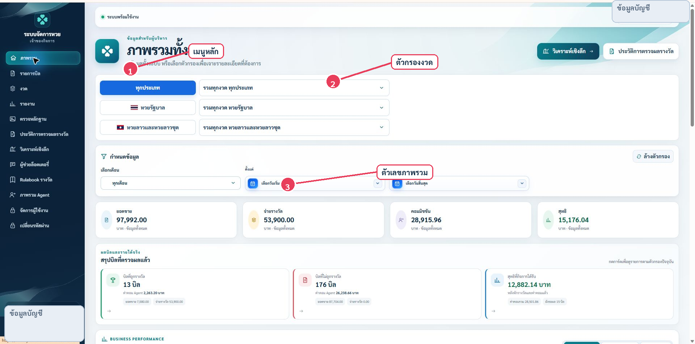

① เมนูหลัก ② ตัวกรองขอบเขตและงวด ③ ตัวเลขภาพรวม ④ แถบผลประกอบการและรายการที่ควรติดตาม  
ขั้นตอน: เลือกประเภทหวย → เลือกงวดหรือช่วงวันที่ → ตรวจป้าย “กำลังดู” → อ่าน KPI และรายการด้านล่าง  
ผลลัพธ์: ทุกการ์ดใช้ขอบเขตเดียวกับตัวกรอง หากมีงวดรอผล ยอดดังกล่าวแยกเป็น “รอผล” และยังไม่รวมกำไร

### 4.2 รายการบิล

**คืออะไร:** ประวัติและพื้นที่จัดการบิล  
**ใช้ทำอะไร:** ค้นหา กรอง ดูรายละเอียด พิมพ์ แก้/ลบก่อน Cutoff และส่งออก Excel  
**เข้าจาก:** “รายการบิล”

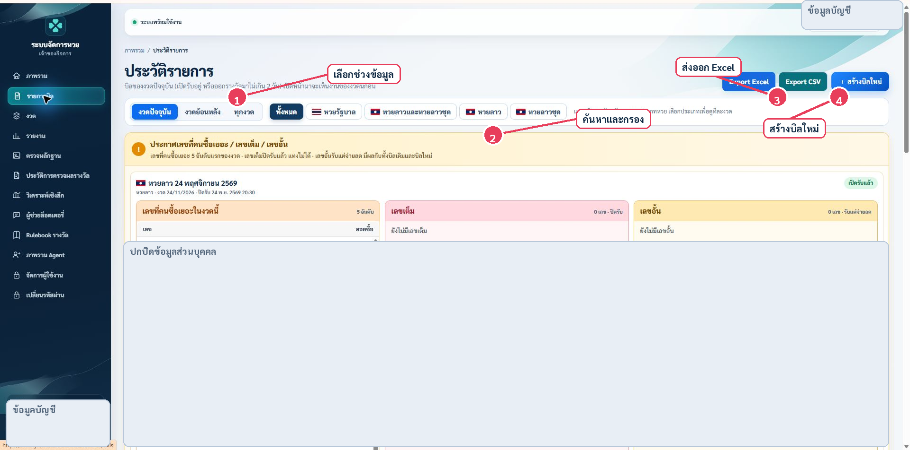

① เลือกข้อมูลล่าสุด/ย้อนหลัง/ทั้งหมด ② กรองประเภทหวย งวด Agent วันที่ สถานะ และคำค้น ③ ส่งออก Excel ตามตัวกรอง ④ สร้างบิลใหม่  
รายการประวัติแสดง 5 รายการล่าสุดก่อน และใช้ “ดูเพิ่มเติม” เพื่อดูทั้งหมดตามการออกแบบปัจจุบัน

#### วิธีสร้างบิล

1. กด “สร้างบิลใหม่”
2. เลือกงวดที่ยัง OPEN
3. กรอกชื่อลูกค้า
4. เพิ่มรายการแทง เลือกประเภทรางวัล เลข และยอด/จำนวนชุด
5. ตรวจยอดรวมและคำเตือนเลขอั้น/เลขเต็ม
6. บันทึกร่างหากยังไม่พร้อม หรือยืนยันเพื่อออกเลขบิล
7. แนบหลักฐานเมื่อจำเป็น

ผลลัพธ์สำเร็จ: บิลยืนยันมีเลขลำดับ อัตราจ่าย snapshot และรวมในยอดขาย  
Validation สำคัญ: ต้องมีอย่างน้อย 1 รายการ, จำนวนหลักตรงประเภทรางวัล, ยอดมากกว่า 0 และไม่น้อยกว่าขั้นต่ำ, ไม่เกินยอดต่อรายการ/ต่อเลข/วงเงิน Agent, หวยลาวชุดใช้ราคาชุดที่ระบบรองรับ, ห้ามรายการซ้ำ, ห้ามรับเลขเต็ม และต้องไม่เลย Cutoff

### 4.3 จัดการงวด

**คืออะไร:** จัดการรอบรับบิลและสถานะการคำนวณ  
**เข้าจาก:** “งวด”

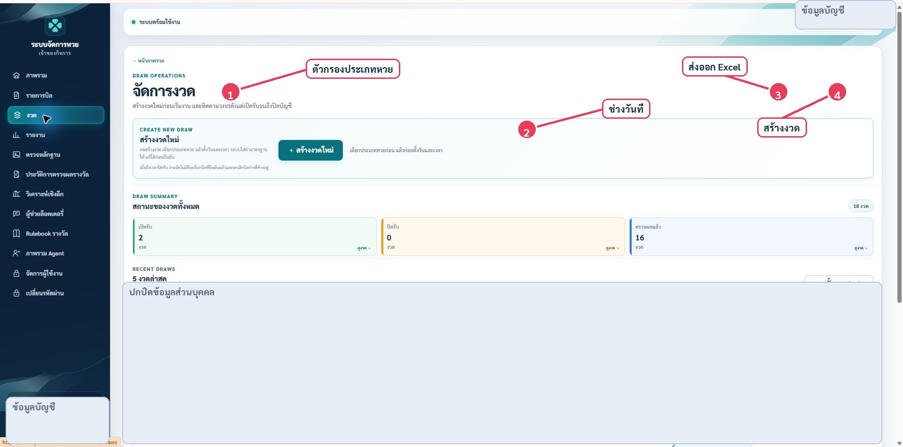

① เลือกประเภทหวย ② เลือกงวด/ช่วงวันที่/เดือน ③ Export Excel ④ สร้างงวด  
หน้าแรกแสดง 5 งวดล่าสุด และ “ดูงวดทั้งหมด” เปิดรายการทั้งหมด

ขั้นตอนสร้างงวด:

1. กด “สร้างงวด” และเลือกประเภทหวย
2. กรอกชื่อ วันที่ออกผล และ Cutoff
3. ตรวจเวลาและบันทึก
4. ก่อน Cutoff สามารถจัดการเลขเต็ม เลขอั้น และเพดานต่อเลขตามสิทธิ์
5. เมื่อถึงเวลาหรือพร้อมปิด กดปิดงวด ระบบล็อกบิลยืนยันและยกเลิกร่างค้าง

Owner/Admin เปิดรับงวดอีกครั้งได้หากยังไม่มีผลหรือ Settlement ส่วนการลบงวดเป็นสิทธิ์ Owner และอาจลบบิลในงวดนั้น จึงต้องตรวจชื่อและจำนวนบิลในข้อความยืนยันทุกครั้ง

### 4.4 Rulebook รางวัล

**คืออะไร:** แหล่งอ้างอิงประเภทเลข จำนวนหลัก วิธีจับคู่ อัตราจ่าย และเพดาน  
**เข้าจาก:** “Rulebook รางวัล”

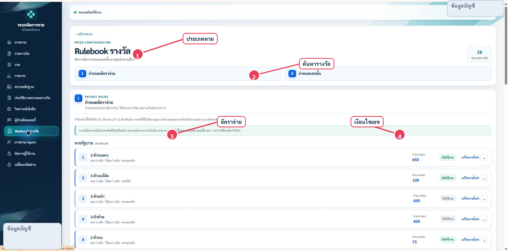

① เลือกประเภทหวย ② ค้นหาประเภทรางวัล ③ ตรวจอัตราจ่าย ④ ตรวจเงื่อนไข/เพดาน  
Rulebook ปัจจุบันมีประเภทข้อมูลจริงจากฐานระบบ การแก้อัตราจ่ายใหม่ไม่เปลี่ยนบิลที่ยืนยันแล้ว เพราะบิลเก็บ payoutRateSnapshot

### 4.5 ลงผล ตรวจผล และคำนวณเงิน

**คืออะไร:** กระบวนการบันทึกผลรางวัล จับคู่ผู้ชนะ และสร้าง Settlement  
**เข้าจาก:** เปิดรายละเอียดงวด

1. เปิดงวดสถานะ RESULT_PENDING หรือหน้าที่ระบบอนุญาต
2. กรอกผลให้ครบทุกรางวัล แล้วตรวจจำนวนหลัก
3. บันทึกผล หากผลครบระบบคำนวณการเงินให้ Agent ที่เกี่ยวข้อง
4. Admin กระทบยอด Settlement
5. Owner อนุมัติและปิดบัญชี

วิธีจับคู่: EXACT ต้องตรงทุกหลัก, PERMUTATION ยอมรับการสลับตำแหน่ง, CONTAINS_DIGIT ตรวจว่าตัวเลขที่แทงอยู่ในผล  
ข้อควรระวัง: การแก้ผลหลังประกาศต้องมีเหตุผลและ Audit; Admin ส่งคำขอให้ Owner อนุมัติ

### 4.6 รายงาน

**คืออะไร:** ภาพรวมการเงินและผลการดำเนินงาน  
**เข้าจาก:** “รายงาน”

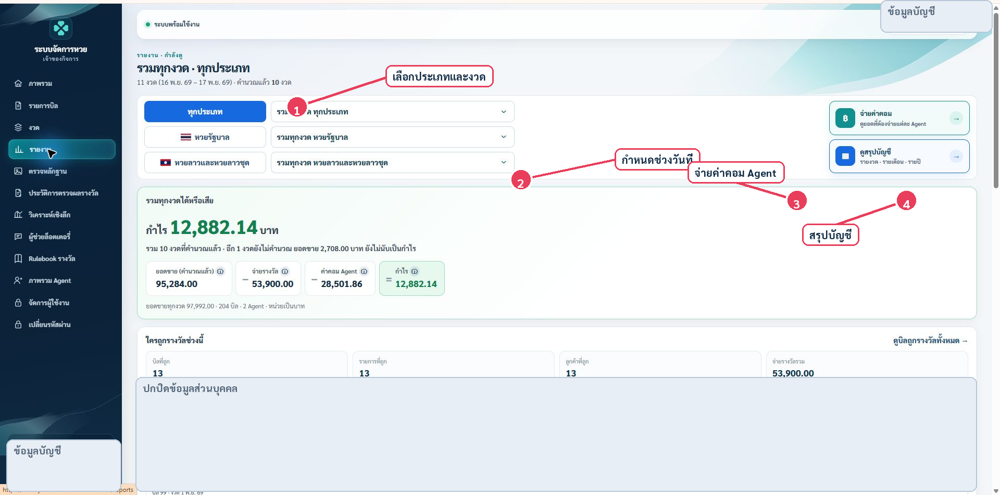

① เลือกประเภทและงวด ② กำหนดเดือน/วันเริ่ม/วันสิ้นสุด ③ รายการเตรียมจ่ายค่าคอม Agent ④ สรุปบัญชี  
ปุ่ม Export Excel ส่งข้อมูลตามขอบเขตที่เลือก ระบบปัจจุบันมีหน้ารายงานย่อยบิลถูกรางวัล สรุปบัญชี และคอมมิชชัน

#### สรุปบัญชีและการเปรียบเทียบ

สรุปบัญชีแยก “รายงวด” และ “แต่ละ Agent” ในไฟล์ Excel รวมถึงหน้ารายละเอียด ใช้ตัวกรองประเภทหวย งวด ช่วงวันที่ เดือน และ Agent  
เมื่อเปิดเปรียบเทียบ สามารถเลือกคู่หวย “ทั้งหมด (ไทย↔ลาว)”, “ไทย↔ไทย” หรือ “ลาว↔ลาว” เลือกข้อมูลช่วง A และ B ได้อิสระ ค่าเริ่มต้นของงวดและ Agent เป็น “ทั้งหมด” และมีปุ่มสลับสองฝั่ง

สูตรส่วนต่าง: **B − A**  
เปอร์เซ็นต์: **(B − A) ÷ |A| × 100**  
กรณี A = 0 จะไม่แสดงเปอร์เซ็นต์และใช้คำว่า “เริ่มมีรายการ” หาก A = B แสดง “เท่าเดิม”

กฎสี:

| รายการ | เพิ่มขึ้น | ลดลง |
|---|---|---|
| กำไร/ขาดทุน | ดีขึ้นเมื่อค่ากำไรสุทธิเพิ่ม | แย่ลงเมื่อกำไรลดหรือขาดทุนเพิ่ม |
| ยอดขาย | เขียว/ดีขึ้น | แดง/ลดลง |
| จ่ายรางวัล / ค่าคอม | แดงเมื่อค่าใช้จ่ายเพิ่ม | เขียวเมื่อค่าใช้จ่ายลด |
| จำนวนบิล / ผู้ถูกรางวัล | น้ำเงินหรือเทา เป็นข้อมูลทั่วไป | น้ำเงินหรือเทา เป็นข้อมูลทั่วไป |

ตัวอย่าง: A กำไร 10,836 และ B ขาดทุน 155,873.60 → ผลประกอบการแย่ลง 166,709.60 บาท ไม่ใช่ดีขึ้น ระบบแสดง “พลิกจากกำไรเป็นขาดทุน”  
ส่วนสรุปผลแบ่ง 3 ช่อง: ช่วง A, ช่วง B และผลรวม/ผลต่าง และมีคำอธิบายภาษาคนใต้ตาราง

### 4.7 จ่ายค่าคอม Agent

**คืออะไร:** เช็กลิสต์รายการเตรียมจ่ายและประวัติการทำเครื่องหมายจ่าย  
**เข้าจาก:** รายงาน → จ่ายค่าคอม Agent  
เลือกวันเริ่มและวันสิ้นสุด ตรวจ Agent/งวด/ยอด แล้วทำเครื่องหมายจ่ายตามสิทธิ์ `commission.markPaid` ระบบเก็บ snapshot เพื่อ Audit แต่ไม่ได้โอนเงินจริงหรือตัดเงินอัตโนมัติ

### 4.8 ตรวจหลักฐานจากลูกค้า

**คืออะไร:** ตรวจสลิปหรือไฟล์หลักฐานที่แนบกับบิล  
**เข้าจาก:** “ตรวจหลักฐาน” (Owner/Admin)

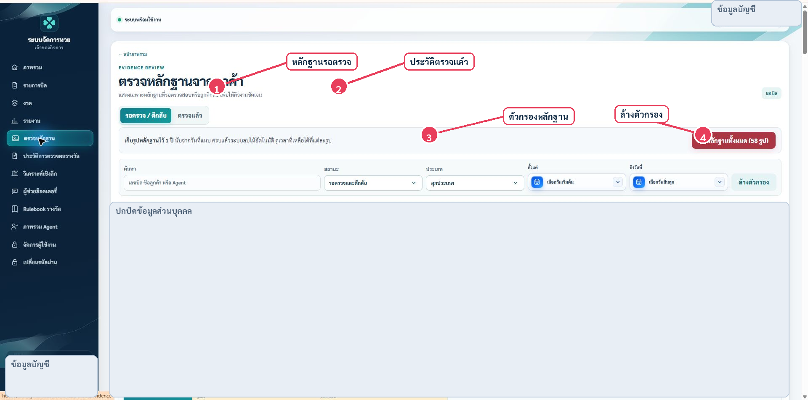

① หลักฐานรอตรวจ/ถูกปฏิเสธ ② ประวัติตรวจแล้ว ③ กรองประเภท งวด Agent วันที่ และสถานะ ④ ล้างตัวกรอง  
เปิดไฟล์จาก Private Storage ตรวจความซ้ำและบิลที่เกี่ยวข้อง แล้วเลือกยืนยันหรือปฏิเสธพร้อมเหตุผล เจ้าของกิจการมีสิทธิ์ลบหลักฐาน ส่วน Admin ไม่มีสิทธิ์ลบ Agent อัปโหลดและดูหลักฐานของตนได้แต่ตรวจอนุมัติไม่ได้

### 4.9 ประวัติการตรวจผลรางวัลและ Audit

**คืออะไร:** ตรวจย้อนหลังว่าใครเปลี่ยนแปลงอะไร เมื่อใด และผลเป็นอย่างไร  
**เข้าจาก:** “ประวัติการตรวจผลรางวัล”

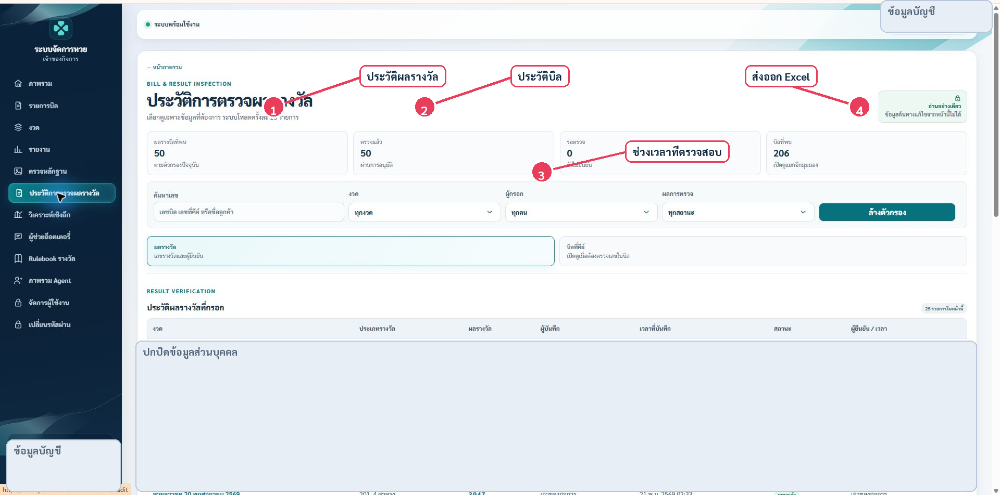

① ประวัติผลรางวัล ② ประวัติบิล ③ กรองประเภทหวย งวด Agent และช่วงวันที่ ④ Export Excel  
ประวัติหน้าแรกแสดง 5 อันดับล่าสุดและกด “ดูเพิ่มเติม” เพื่อดูทั้งหมด Admin/Owner เห็นทั้งองค์กร ส่วน Agent เห็น Audit ของตนเท่านั้น

### 4.10 ภาพรวม Agent

**คืออะไร:** ดูผลงานและความเสี่ยงราย Agent  
**เข้าจาก:** “ภาพรวม Agent” (Owner/Admin)

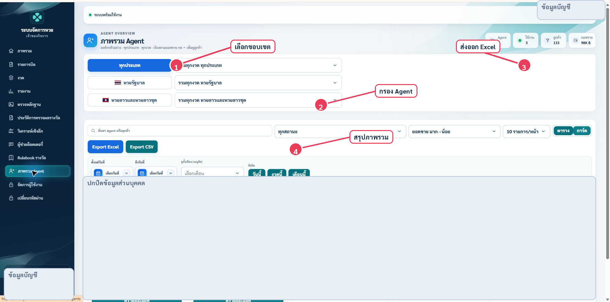

① เลือกประเภท/งวด ② กรอง Agent และช่วงวันที่ ③ Export Excel ④ สรุปยอด  
เปิดรายละเอียด Agent เพื่อดูบิล ลูกค้า ยอดขาย จ่ายรางวัล ค่าคอม และกำไรในขอบเขตที่เลือก การแก้สถานะหรือข้อมูล Agent เป็นสิทธิ์ Owner เท่านั้น

### 4.11 จัดการผู้ใช้งาน

**คืออะไร:** สร้าง แก้ไข ระงับ Reset และลบบัญชี  
**เข้าจาก:** “จัดการผู้ใช้งาน” (Owner เท่านั้น)

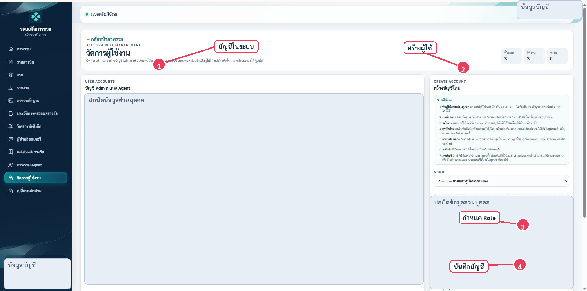

① รายชื่อบัญชี ② แบบสร้างผู้ใช้ ③ กำหนด Role ④ บันทึก  
เมื่อสร้าง Role Agent ระบบสร้างโปรไฟล์ Agent/รหัส Agent ตามข้อมูลที่กรอก การลบบัญชีที่มีประวัติบิลจะเก็บประวัติทางธุรกิจไว้และเอาบัญชีออกจากรายการใช้งาน ข้อมูลของผู้ใช้ที่ลบต้องไม่ถูกนับในภาพรวม Agent ที่ Active ตามพฤติกรรมปัจจุบัน

ข้อควรระวัง: จดรหัสชั่วคราวให้ผู้รับอย่างปลอดภัยเพียงครั้งเดียว ห้ามใส่รหัสผ่านในคู่มือหรือแชตสาธารณะ และตรวจชื่อบัญชีก่อนลบเสมอ

### 4.12 วิเคราะห์พฤติกรรมลูกค้าเชิงลึก

**คืออะไร:** Dashboard เชิงวิเคราะห์สำหรับ Owner  
**เข้าจาก:** “วิเคราะห์เชิงลึก”

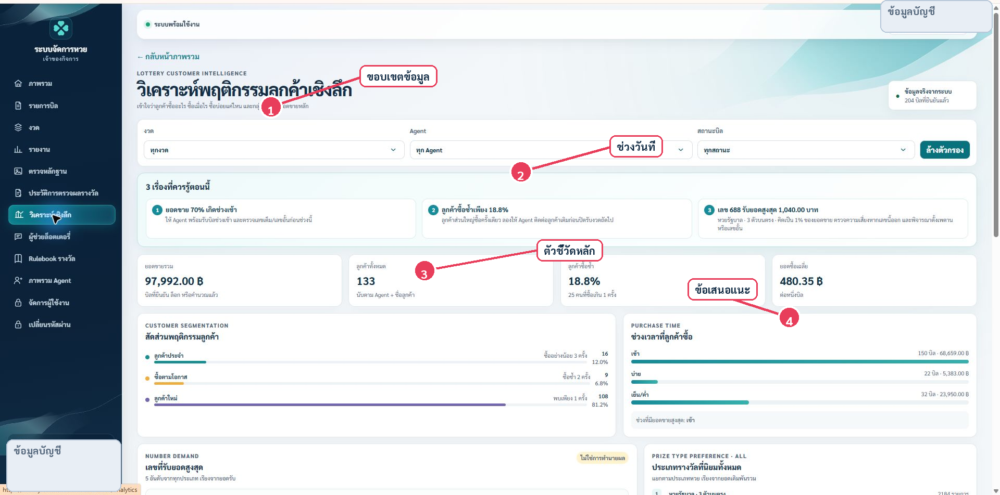

① ขอบเขตประเภทหวย/งวด ② เดือนหรือช่วงวันที่ ③ KPI เช่น ลูกค้า บิล ยอด และค่าเฉลี่ย ④ Insight/ข้อเสนอแนะ  
ข้อมูลลูกค้าอาศัยชื่อในบิลที่ผ่านการ normalize จึงควรใช้ชื่อให้สม่ำเสมอ ผลวิเคราะห์เป็นข้อมูลสนับสนุนการตัดสินใจ ไม่ใช่การรับประกันผลในอนาคต

### 4.13 ผู้ช่วยล็อตเตอรี่ AI

**คืออะไร:** ผู้ช่วยสนทนาสำหรับ Owner ที่ใช้บริบทเมนูและข้อมูลระบบ  
**เข้าจาก:** “ผู้ช่วยล็อตเตอรี่”

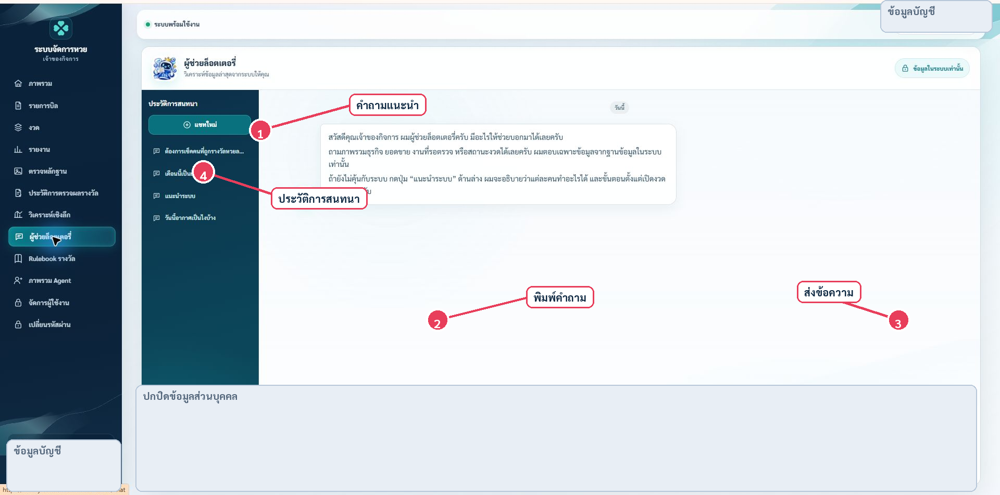

① คำถามแนะนำ ② ช่องคำถาม ③ ปุ่มส่ง ④ ประวัติสนทนา  
ระบบเชื่อมต่อ OpenTyphoon ตามการตั้งค่าฝั่ง Server ห้ามส่ง Password, Token, API Key หรือข้อมูลส่วนบุคคลที่ไม่จำเป็น คำตอบ AI อาจผิดพลาด ต้องตรวจตัวเลขกับรายงานก่อนตัดสินใจทางการเงิน

### 4.14 การแจ้งเตือนและการเชื่อมต่อภายนอก

ระบบรองรับ Telegram สำหรับหลักฐานรอตรวจ สรุปรายวัน และรับการกดปุ่มกลับผ่าน Worker/Job การตั้งค่าทำโดยผู้ดูแลระบบ ไม่ใช่หน้าผู้ใช้ ไฟล์หลักฐานเก็บใน S3-compatible Private Storage และ API ดาวน์โหลดตรวจสิทธิ์ก่อนส่งไฟล์ ระบบมี Health API และ Job สำหรับ Cutoff/Notify  
หาก Telegram ล่ม การส่งแจ้งเตือนต้องไม่หยุดเส้นทางการเงินหลัก และไม่ควรรันตัวรับ Telegram แบบ watch ซ้ำสองชุด เพราะจะแย่งกันอ่านคิว

## PART 5 — Workflow งานสำคัญ

### 5.1 เริ่มต้นใช้งานพนักงานใหม่

จุดเริ่มต้น: Owner สร้างบัญชี → ส่งชื่อผู้ใช้/รหัสชั่วคราวอย่างปลอดภัย → ผู้ใช้ Login → เปลี่ยนรหัสผ่าน → ตรวจเมนูตาม Role  
เงื่อนไข: บัญชีและองค์กร Active  
หากผิดพลาด: ตรวจชื่อผู้ใช้ สถานะบัญชี และติดต่อ Owner เพื่อ Reset

### 5.2 รับบิลจนยืนยัน

จุดเริ่มต้น: งวด OPEN และยังไม่ถึง Cutoff → สร้างบิล → ใส่ลูกค้าและรายการ → ตรวจ Validation → บันทึกร่าง/ยืนยัน → แนบหลักฐาน  
ผลลัพธ์: เลขบิลถูกออกและยอดเข้ารายงาน  
หากผิดพลาด: แก้เลข/ยอดตามข้อความ หรือตรวจเลขเต็ม เพดาน และวงเงิน Agent

### 5.3 ปิดงวดจนปิดบัญชี

ปิดรับงวด → ล็อกบิล → ลงผลให้ครบ → คำนวณ Settlement → Admin กระทบยอด → Owner อนุมัติ → งวด CLOSED  
หากผลไม่ครบ ระบบแจ้งว่าจะคำนวณเมื่อผลครบทุกรางวัล หากคำนวณล้มเหลว ห้ามปิดบัญชีจนตรวจ Error และยอดใหม่

### 5.4 ตรวจหลักฐาน

เปิดรายการ PENDING → เปิดไฟล์ → ตรวจบิล/ความซ้ำ → VERIFIED หรือ REJECTED พร้อมเหตุผล → ตรวจประวัติ  
หากไฟล์เปิดไม่ได้: ตรวจ Storage, สิทธิ์ และสถานะไฟล์ ห้ามรับรองจากภาพที่มองไม่เห็น

### 5.5 ค้นหา กรอง และ Export

เลือกประเภทหวย → เลือกงวด/เดือน/ช่วงวันที่ → เลือก Agent/สถานะ → ตรวจข้อความขอบเขต → กด Export Excel  
ผลลัพธ์: ไฟล์ต้องสะท้อนตัวกรองหน้าเดียวกัน รายงานสรุปบัญชีแยก Sheet รายงวดและแต่ละ Agent  
ข้อควรระวัง: หากหน้า Production ยังแสดง Export CSV แสดงว่า Deployment ยังไม่ตรงกับ Repository รุ่นนี้

## PART 6 — ตัวเลขและการคำนวณ

### 6.1 สูตรหลัก

ยอดขาย = ผลรวม `totalStake` ของบิลยืนยัน/ล็อก/คำนวณแล้วตามขอบเขต  
ค่าคอม = ยอดขาย × อัตราคอมประเภทหวยของ Agent ÷ 100 (หรือใช้ค่าจริงจาก Settlement หากมี)  
หลังหักคอม = ยอดขาย − ค่าคอม  
กำไร/ขาดทุน = ยอดขายของงวดที่คำนวณแล้ว − จ่ายรางวัล − ค่าคอมของงวดที่คำนวณแล้ว

งวดรอผลมี payout = 0 เพื่อการแสดงยอดรอผล แต่ `profit` เป็นค่าว่าง ไม่ใช่กำไร ยอดดังกล่าวจึงต้องไม่รวมในผลประกอบการ

### 6.2 การคำนวณรางวัล

แต่ละรายการเก็บเลข ประเภทรางวัล ยอดเดิมพันหรือราคาแพ็กเกจ จำนวนชุด และอัตราจ่าย snapshot การจ่ายขึ้นกับ MatchRule และอัตราที่ snapshot ตอนยืนยันบิล หากเลขอยู่ในสถานะ REDUCED_RATE ระบบใช้อัตราลดลงที่กำหนด

### 6.3 วิธีอ่านผลเปรียบเทียบ

ทิศทางลูกศรบอกว่าตัวเลขเพิ่มหรือลด สีบอกผลกระทบทางธุรกิจ เช่น ค่าคอมลดลงใช้ลูกศรลงแต่สีเขียว จ่ายรางวัลเพิ่มใช้ลูกศรขึ้นแต่สีแดง จำนวนบิลและผู้ถูกรางวัลเป็นสีทั่วไป เพราะมากหรือน้อยไม่ได้สรุปว่าดีหรือแย่โดยลำพัง

## PART 7 — Troubleshooting

| ปัญหา | สาเหตุที่ตรวจสอบได้ | วิธีแก้ไข |
|---|---|---|
| Login ไม่ได้ | ช่องว่าง, ข้อมูลไม่ถูกต้อง, Session/สถานะบัญชี, ไม่มีองค์กร Active | กรอกใหม่ ตรวจสถานะกับ Owner หรือให้ผู้ดูแลตรวจ seed/organization |
| ถูกพาไปหน้าเปลี่ยนรหัสผ่าน | `mustChangePassword` เป็นจริง | ตั้งรหัสใหม่และ Login ใหม่ |
| ไม่เห็นเมนู | Role ไม่มีสิทธิ์ หรือ Session เก่า | ตรวจตาราง Role, Logout/Login; หาก Role ผิดให้ Owner แก้ |
| สร้างบิลไม่ได้ | งวดไม่ OPEN/เลย Cutoff/ไม่มีรายการ/เลขผิดหลัก/เกินวงเงิน | อ่านข้อความแดง แก้รายการหรือเลือกงวดที่เปิด |
| เลขรับไม่ได้ | เลขเต็มหรือเกินเพดาน | ลดจำนวน/เลือกเลขอื่น; Owner ตรวจ Override หากมีเหตุผล |
| บันทึกผลแล้วไม่คำนวณ | ผลยังไม่ครบทุกประเภทรางวัล | กรอกให้ครบและบันทึกอีกครั้ง |
| แก้ผลไม่ได้ | งวดปิดแล้วหรือ Role ไม่มีสิทธิ์ | Admin ส่งคำขอแก้; Owner อนุมัติพร้อมเหตุผล |
| ไม่มีตัวเลขกำไร | งวดยังรอผล/ยังไม่ Settlement | ตรวจสถานะงวดและลงผลให้ครบ |
| เปอร์เซ็นต์ไม่แสดง | ค่า A = 0 | อ่านจำนวนส่วนต่างและคำว่า “เริ่มมีรายการ” |
| ไฟล์หลักฐานเปิดไม่ได้ | Storage/สิทธิ์/ไฟล์หาย | ลองใหม่ ตรวจสถานะไฟล์และแจ้งผู้ดูแล Storage |
| Telegram ไม่แจ้ง | ยังไม่ตั้งค่า, Token/Chat ผิด, Worker ไม่ทำงาน | ผู้ดูแลรันเครื่องมือตรวจ Telegram และตรวจ Job |
| AI ตอบไม่ได้ | Key/Model/Base URL ผิด หรือ Provider ล่ม | ผู้ดูแลตรวจการตั้งค่า Typhoon; ใช้รายงานปกติแทน |
| Export ไม่ตรงหน้าจอ | ตัวกรองเปลี่ยน หรือ Deployment คนละรุ่น | ตั้งตัวกรองใหม่ ตรวจชื่อไฟล์/Sheet และแจ้งผู้ดูแล Deploy |

## PART 8 — FAQ

### เข้าสู่ระบบครั้งแรกอย่างไร
ใช้บัญชีที่ Owner ให้ หากระบบขอเปลี่ยนรหัสผ่านต้องทำก่อนเข้าสู่เมนูอื่น

### ทำไม Agent ไม่เห็น Dashboard และจัดการผู้ใช้
เป็นข้อจำกัดสิทธิ์ Agent ซึ่งเห็นเฉพาะงานบิล งวด รายงานของตน Audit ของตน หลักฐาน และเปลี่ยนรหัสผ่าน

### บิลร่างนับยอดขายหรือไม่
ไม่นับ ยอดขายนับจากบิลที่ยืนยันแล้ว และไม่รวมบิลที่ลบ

### ทำไมงวดรอผลไม่มีกำไร
เพราะยังไม่ทราบยอดจ่ายรางวัล ระบบจึงแยกเป็น “รอผล” และไม่สมมติว่าเป็นกำไร

### Export Excel อยู่ตรงไหน
หน้ารายการบิล งวด ประวัติ และรายงานมีปุ่ม Export Excel ตามสิทธิ์และขอบเขตตัวกรอง

### เปลี่ยนผลรางวัลหลังประกาศได้ไหม
ได้ตาม Workflow ที่มีเหตุผลและ Audit โดย Admin ส่งคำขอให้ Owner หรือ Owner แก้พร้อมคำนวณใหม่

### จำนวนบิลลดลงถือว่าแย่หรือไม่
ระบบถือเป็นข้อมูลทั่วไป ไม่ตัดสินดี/แย่จากจำนวนเพียงอย่างเดียว ต้องดูยอดขาย ต้นทุน และบริบทประกอบ

### ลบผู้ใช้แล้วข้อมูลเก่าหายไหม
หากมีประวัติบิล ระบบเก็บประวัติธุรกิจไว้เพื่อ Audit แต่เอาบัญชีออกจากการใช้งานและไม่ควรนับเป็น Agent ที่ Active

### ต้องเชื่อตัวเลขจาก AI หรือไม่
ไม่ควรเชื่อโดยไม่ตรวจสอบ ให้ยืนยันกับรายงานและข้อมูลจริงทุกครั้ง

## ภาคผนวก — ขอบเขตการตรวจสอบ

สำรวจหน้าเว็บ 23 Route, API 30 Route, เมนูหลัก 12 รายการ และ Role 3 บทบาท ตรวจหน้าจอจริง 13 หน้าสำคัญด้วย Session Owner และหน้า Login แบบไม่ยืนยันตัวตน ไม่ได้กดคำสั่งที่สร้าง แก้ไข ลบ อนุมัติ ส่งข้อความ AI หรือส่งออกข้อมูลจริง การตรวจ Admin/Agent ทำจาก Permission Matrix, Navigation, Server Actions และ Database Schema เนื่องจากไม่มีรหัสผ่านทดสอบ
